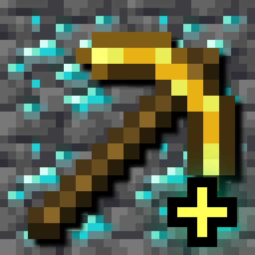

<p align="center"></p>

# Vein Expansion

**Yapımcı / Creator: Renterq** — [Veinminer](https://modrinth.com/mod/veinminer) (Miraculixx) için eklenti.

| Minecraft | Loader | Modül | Derlenen Veinminer |
|---|---|---|---|
| 1.20.1 | Forge (same jar loads on NeoForge 1.20.1) | `versions/forge-1.20.1` | veri paketi 1.1.0 yöntemi, bkz. aşağısı |
| 1.21.1 | NeoForge | `versions/neoforge-1.21.1` | 2.11.2 |
| 1.21.11 | NeoForge | `versions/neoforge-1.21.11` | 2.11.2 |
| 26.1 / 26.1.x | NeoForge | `versions/neoforge-26.1` | 2.10.4 |
| 26.2 | NeoForge | `versions/neoforge-26.2` | 2.12.1 |
| 26.3 | NeoForge | `versions/neoforge-26.3` | 2.12.3 |

Ortak kod `common/`, sürüm farkları `compat/` içinde (`1.20.1`, `pre-26.1`, `26.1`, `26.2`).

Veinminer'a hazır blok grupları ekler (`config/Veinminer/groups.json` içine `Renterq-` önekiyle yazılır):

| Grup | Araç | İçerik |
|---|---|---|
| `Renterq-Andesite` | kazma | Andesite + Create'in andesite yapı blokları |
| `Renterq-Stones` | kazma | Tüm taşlar + Create doğal taşları |
| `Renterq-Logs` | balta | `#minecraft:logs` (vanilla, Nature's Spirit, Biomes O' Plenty ...) |
| `Renterq-Custom` | seçtiğin alet | Senin eklediğin bloklar / tag'ler |
| `Renterq-Mod-<modid>` | herhangi alet | Seçtiğin (veya tüm) modların bütün blokları, mod başına bir grup |

## Ayarlar (oyun içi GUI — DuraHUD düzeninde)

Mods menüsü → Vein Expansion → Config. Üç sekme:

- **Genel**: Andesite / Tüm taşlar / Tüm odunlar aç-kapa.
- **Bloklar**: istediğin bloğu id (`minecraft:dirt`) veya tag (`#minecraft:logs`) olarak yaz, ya da *Blok seç...* ile oyundaki tüm blokların aranabilir listesinden seç. Alet türünü seç (kazma / balta / kürek / çapa / hepsi).
- **Modlar**: *Tüm modlar* ya da *Mod seç...* ile yüklü modların bütün bloklarını ekle. *Sandık/makine hariç* açıkken blok-entity'li bloklar (sandık, makine) atlanır.

Dosya: `config/vein_expansion.json` (elle de düzenlenebilir; `createNamespaces`, `andesiteExclude`, `woodNamespaces` sadece dosyada).

Mod blokları, Veinminer grup listesine tek tek yazılmasın diye `config/vein_expansion/generated_pack` içinde otomatik üretilen bir datapack'te `#vein_expansion:mod/<modid>` tag'i olarak tutulur. Mod listesini değiştirince dünyada `/reload` gerekir.

## Derleme

```
gradlew build                       # hepsi; JAVA_HOME = JDK 21 (26.x için Java 25 toolchain otomatik)
gradlew :neoforge-26.2:build        # tek sürüm
gradlew :forge-1.20.1:build         # Forge 1.20.1 (Java 17 toolchain)
```

Jar'lar `versions/<modül>/build/libs/` içinde. NeoForge modülleri derlemek için kendi `libs/` klasörlerine Veinminer jar'ını ister (sadece `compileOnly`, pakete girmez); jar'lar repoda yok, bağlantılar `versions/libs.md` içinde.

## 1.20.1 Forge nasıl çalışır?

Veinminer'ın 1.20.1'de gerçek bir modu yok, tek sürümü 18 maden bloğu sabit yazılmış bir datapack (1.1.0). Bu yüzden 1.20.1 sürümü grupları, o datapack'in yöntemiyle çalışan, otomatik üretilen bir datapack olarak ekler: her blok için `minecraft.mined` skorbordu + bağlı blokları `setblock ... air destroy` ile kıran özyinelemeli bir fonksiyon. Veinminer datapack'inin `cooldown` ve `hunger` ayarlarını varsa okur; o datapack olmadan da çalışır.

Sınırlar (datapack olmanın bedeli): en fazla 1500 blok takip edilir (fazla mod seçersen uyarı verir), bir kırışta en fazla 100 blok kırılır, `#tag` yerine blok id'si gerekir (odunlar otomatik taranır), kırılan bloklar alet aşındırmaz ve Veinminer'ın vurgu/ayar menüsü yoktur. Oyun içi config ekranı aynıdır; değişiklikten sonra `/reload` gerekir.

Uçtan uca test (yerel Forge 1.20.1 sunucu + mineflayer botu): kazmayla 50 taş, baltayla 8 odun, kürekle özel grup (kil) tamamen kırıldı; yanlış aletle (taşa balta, toprağa kürek) zincir başlamadı.
